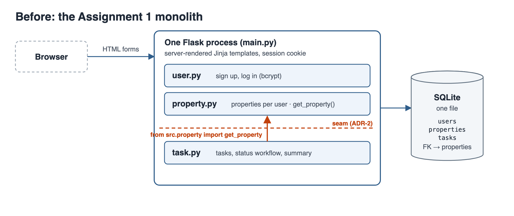
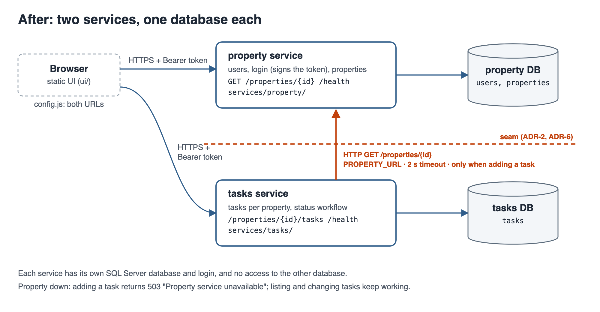
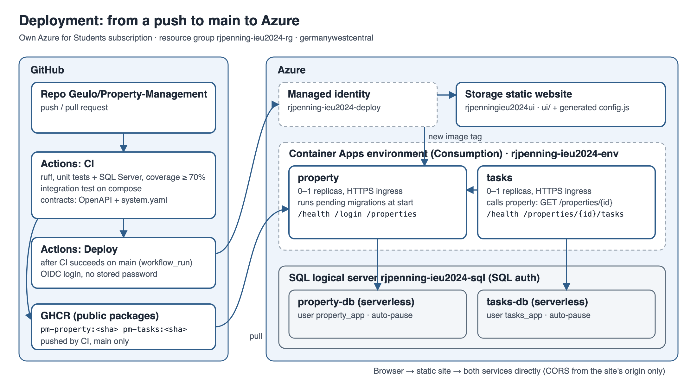
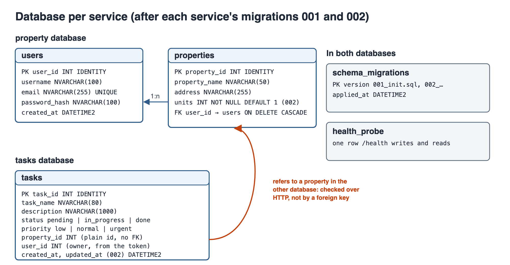
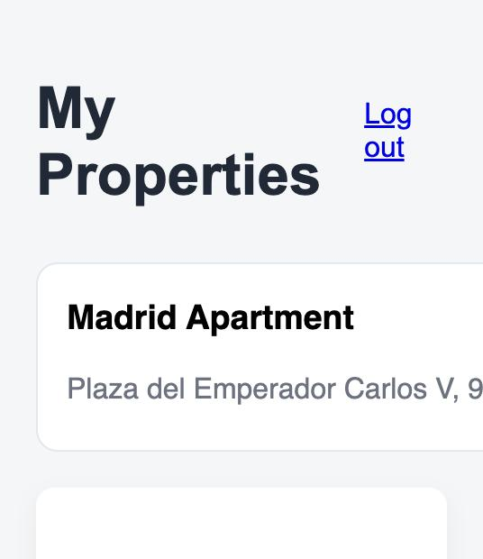
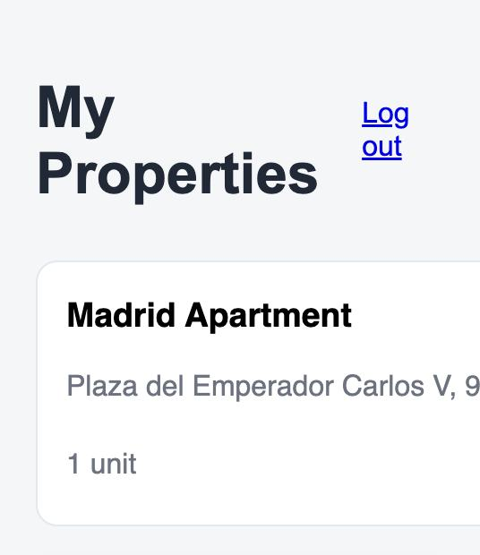
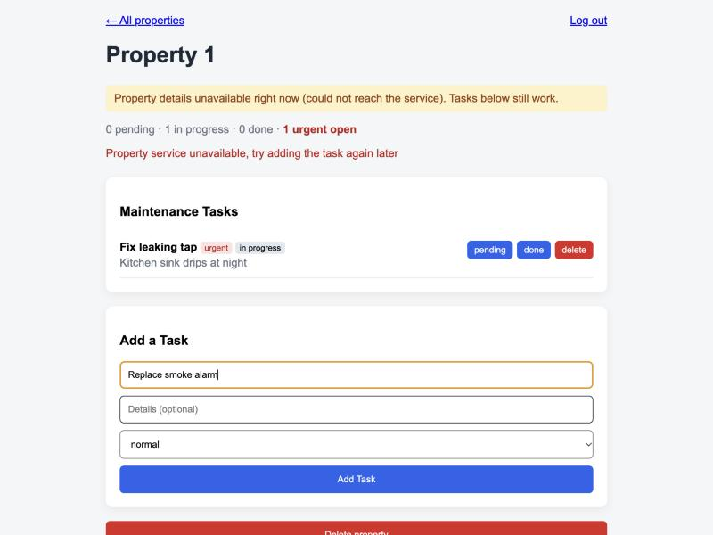
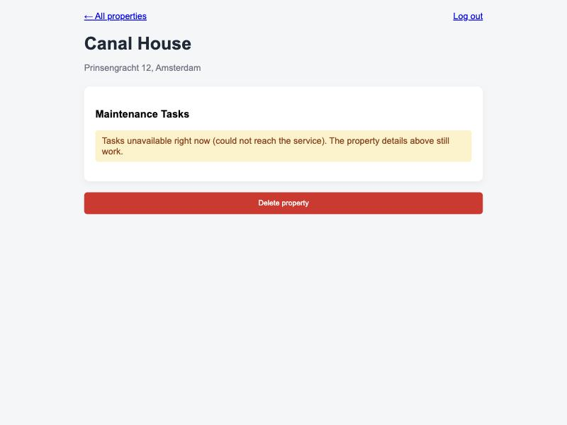

# Property Management: from monolith to two services on Azure

Ruben Penning · IE BCSAI · Software Development and DevOps · Individual Assignment 2 · 24 November 2026

| | |
|---|---|
| Repository | https://github.com/Geulo/Property-Management |
| Graded commit | tag `submission` on `main` (SHA in the submission form) |
| Live UI | https://rjpenningieu2024ui.z1.web.core.windows.net/ |
| property service | https://rjpenning-ieu2024-property.kindpond-7b842bee.germanywestcentral.azurecontainerapps.io |
| tasks service | https://rjpenning-ieu2024-tasks.kindpond-7b842bee.germanywestcentral.azurecontainerapps.io |

The Assignment 1 monolith (a Flask app for landlords tracking maintenance work) is split along the seam from
ADR-2 into a **property** service (accounts, login, properties) and a **tasks** service (maintenance tasks),
each with its own container and its own SQL Server database, behind a static UI. Every push to `main` that
passes CI is deployed to Azure automatically. Decisions are in `ADR.md` (6-10), AI use in `AI_USAGE.md`.

## 1. Architecture, before and after

The seam did not move. In Assignment 1, `task.py` imported `get_property()` from `property.py` to check that
a property belongs to the logged-in user. That import is now one HTTP call, `GET /properties/{id}` from tasks
to property, made only when a task is added (timeout 2 s). Login moved with the users table into property,
which signs a token; tasks checks the token's signature itself, so listing, changing and deleting tasks never
cross the seam.

## 2. Deployment

| Azure resource | Name | Billing |
|---|---|---|
| Container Apps (Consumption, 0-1 replicas) | `rjpenning-ieu2024-property`, `rjpenning-ieu2024-tasks` in `rjpenning-ieu2024-env` | per use, 0 when idle |
| Azure SQL serverless (GP Gen5, 0.5-1 vCore, auto-pause 15 min, 2 GB, LRS) | `rjpenning-ieu2024-property-db`, `rjpenning-ieu2024-tasks-db` on `rjpenning-ieu2024-sql` | per use + storage |
| UI (Storage static website) | `rjpenningieu2024ui` | storage only |
| Deploy identity (OIDC, no stored password) | `rjpenning-ieu2024-deploy` | free |
| Images | `ghcr.io/geulo/pm-property`, `ghcr.io/geulo/pm-tasks` (public, tagged with the commit SHA) | free |

Two disclosed deviations from §7 (README and ADR-8): the course's service principal was never provided, so
everything runs in my own Azure for Students subscription and resource group `rjpenning-ieu2024-rg`; and the
subscription's region policy allows no region where Static Web Apps exist, so the UI is a Storage static
website, which serves the same files over HTTPS and gets its generated `config.js` from the same deploy step.

## 3. Database per service

The foreign key from `tasks.property_id` to `properties` could not survive the split, because the tables are
now in different databases. Adding a task checks the property over HTTP instead; deleting a property leaves
its tasks unreachable rather than deleted (ADR-7).

## 4. Migration evidence on Azure

Migrations are numbered SQL files per service, applied in order at startup and recorded in
`schema_migrations`. Property's `002_add_property_units.sql` adds `units INT NOT NULL DEFAULT 1` to a table
that already held data on Azure.

| | Time (UTC) | Evidence |
|---|---|---|
| Before | 13:50:07 | `GET /properties` on the live service: `{"property_id": 3, "property_name": "Madrid Apartment", "address": "Plaza del Emperador Carlos V, 9", "user_id": 4}`, no `units` |
| Merge | 13:51:20 | PR #7 merged as `db331b0`; CI on main green |
| Deploy | 13:52-13:54 | [Deploy run 45407996889](https://github.com/Geulo/Property-Management/actions/runs/45407996889), new revision on image `pm-property:db331b0` |
| Startup log | 13:53:39 | `applied migration 002_add_property_units.sql` (Container Apps console log) |
| After | 13:55:08 | Same request: same row, same id, name and address, now `"units": 1` |

 

Earlier the same day, tasks' `002_add_task_updated_at.sql` added a column to the live tasks table, backfilled it
from `created_at`, then made it NOT NULL; its log line is `applied migration 002_add_task_updated_at.sql` at
13:36:44. Both migrations have a unit test that replays `001`, inserts a row, applies `002` and checks the row.

## 5. Partial failure

 

With **property** stopped, the tasks service keeps listing and updating tasks; adding one returns
`503 {"error": "Property service unavailable, try adding the task again later"}` within the 2 s timeout, and the
UI shows that message. With **tasks** stopped, the property page still loads and says the tasks are unavailable.
Each `/health` reports only its own database, so the healthy service stays 200. The integration test
`tests/integration/test_cross_seam.py` checks the 503, the time bound and that tasks keeps serving, on the real
compose stack in every CI run.

## 6. Pipeline evidence

- **Successful CD run on main:** [Deploy 45407996889](https://github.com/Geulo/Property-Management/actions/runs/45407996889)
  (the migration deploy above), started by `workflow_run` after CI passed on the same commit.
- **Failed run, fixed:** [Deploy 45395748624](https://github.com/Geulo/Property-Management/actions/runs/45395748624)
  failed its health check: `/health did not return 200 with version a7af458… within 180s`. Cause: `infra/setup.sh`
  created the database logins inside `$(...)`, where `set -e` does not stop the script, and `sqlcmd` failed because
  the new firewall rule was not active yet, so a password that was never set was stored as a GitHub secret. The
  services could not log in to SQL (error 18456) and `/health` stayed 503. Fix in `0a66b57`: retry `sqlcmd`,
  fail loudly, and test each new login before storing it; the workflow runs every step with `pipefail`. The next
  run, [45397078823](https://github.com/Geulo/Property-Management/actions/runs/45397078823), passed.
- One run before that, [45395611136](https://github.com/Geulo/Property-Management/actions/runs/45395611136), failed
  because the test checked out `main`, which did not have `infra/` yet; fixed by checking out the branch while testing.

CI on every push and pull request runs ruff, the unit tests of each service against a throwaway SQL Server with a
70% coverage gate (property 96%, tasks 98%), the cross-seam integration test on the compose stack, the contract
checks (`system.yaml` against `system.schema.json`, both OpenAPI documents) and both image builds. Every change
reached `main` through a pull request (#1-#10).

## 7. README

`README.md` covers running locally with compose, running a single service, tests and coverage, how deployment
works, how to reproduce the initial Azure setup (`infra/setup.sh`) and the live URL.

## 8. AI disclosure

I used Claude Code (Claude Opus 5.5) throughout this assignment: to split the code into services, write the
Dockerfiles, compose file, migrations, workflows, setup script, OpenAPI documents and tests, to run side sessions
in parallel on separate branches, and to draft the README, this report and the AI log. I made the design
choices (SQL Server, token login, failing fast when property is down, my own Azure subscription, a second
migration with proper evidence), ran every step that handled secrets myself, and the ADRs and the "In my own
words" column of `AI_USAGE.md` are written from my own answers. Every AI contribution is logged with my prompt
in `AI_USAGE.md`. I also asked a classmate's Claude how they deployed without the course's service principal
and used their lessons, not their code.
